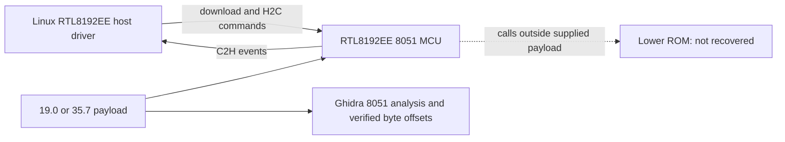

# HGW500 Realtek 8051 microfirmware

> Public source snapshot. [Scope, provenance and verification](docs/PUBLIC_SNAPSHOT.md).

The RTL8192EE radio has its own 8051 MCU. This repository preserves two generic firmware variants and their static analysis. It is separate from the ARC/Linux host driver: changing one side does not automatically establish compatibility with the other.

## How this component fits



This diagram shows software ownership and analysis flow, not a complete board schematic.
The [system architecture](docs/SYSTEM_ARCHITECTURE.md) explains the ARC750 host,
MuC, AuC, DSP and Realtek 8051, with their memory and firmware boundaries.

## What is established

| Area | Recorded scope |
| --- | --- |
| Preserved variants | 19.0: 31,818 bytes; 35.7: 32,286 bytes. These are versions for one MCU, not two additional processors. |
| Original export | 138 and 335 discovered functions respectively, with per-function C and retained instruction listings. |
| Coverage | Initial instruction-byte coverage was 29.16% and 34.06%; a later 35.7 campaign expands discovery. Those are static-analysis checkpoints, not full ROM recovery. |
| Tooling | Ghidra 12.1.3, 8051:BE:16:default, payload CODE base 0x4000. REA 6.8.0 RAW did not support this 8051 input. |

## Start reading here

1. [Component handoff](docs/PROJECT_HANDOFF.md): inputs, evidence and next work.
2. [System architecture](docs/SYSTEM_ARCHITECTURE.md): processors and firmware families.
3. [Firmware contents](docs/FIRMWARE_MAP.md): OEM, Core Boot R1 and API v2 R3.
4. [Repository map](docs/REPOSITORY_MAP.md): host drivers, payloads and integration.
5. [Published checkout availability](docs/CHECKOUT_AVAILABILITY.md): actual remote source inventory.
6. [Preserved technical notes](docs/REFERENCE_NOTES.md): detailed earlier results, with workstation paths normalized.

## Work in progress

Resolve the missing lower ROM, indirect calls and remaining H2C/C2H semantics. Keep the initial exports and later expanded discovery distinguishable. Physical acceptance of a chosen payload belongs to an exact integration image.

## Offline verification


```sh
python tools/verify_public_export.py
```

This checks the published file inventory. Original preservation verifiers and
receipts describe the private source checkpoint; they can require omitted native
databases or external inputs and are not a fresh public-snapshot qualification.

## Preservation and scope

This is a public source snapshot; per-unit data and original private histories remain private. Original vendor/GPL source, notices, comments,
carriers and immutable evidence retain their authorship and provenance. Derived
C is labelled as inferred analysis, not silently presented as original source.
Credentials, unit identity, calibration, personalized rootfs/flash images and
workstation-specific configuration stay outside documentation exports.

Documentation prepared 2026-11-10 from recorded source/evidence. No device access,
firmware installation, radio change or new physical qualification is implied.
